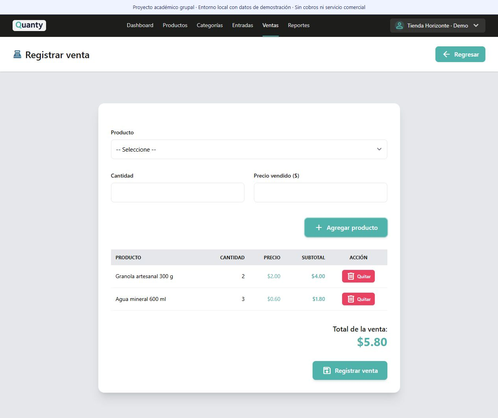
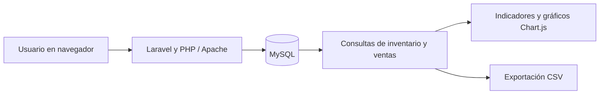

# QUANTY · Inventario y ventas para pequeños negocios

**Laravel · PHP · MySQL · Docker · Reportes operativos**

Caso académico de una aplicación web para organizar productos, registrar entradas y ventas, y consultar reportes operativos. Trabajé en este proyecto en grupo durante Emprendedurismo, ciclo 8 de 2025, en la UEES.

## El problema que buscamos atender

Partimos de una situación sencilla: un pequeño negocio que lleva sus existencias y ventas en registros manuales puede tener dificultades para saber qué reponer, qué se vende y qué productos permanecen sin movimiento. Nuestra propuesta fue reunir esas tareas en una interfaz accesible, con cuentas y datos separados por usuario.

En este repositorio presento el caso y sus evidencias. La implementación se mantiene por separado. Todos los importes de las capturas proceden de una **simulación académica**, no de ventas reales ni de resultados de una empresa.

## Preguntas que orientan el caso

- ¿Qué productos necesitan reposición y cuáles están agotados?
- ¿Cuánto se vende por período y cuál es el ticket promedio?
- ¿Qué artículos se venden más y cuáles permanecen sin movimiento?
- ¿Qué categorías aportan ingresos y cómo se relacionan las ventas con el costo de mercadería?

## Qué demuestra el recorrido

- Crear un producto, asignarle categoría y registrar un lote con costo, precio y vencimiento.
- Preparar una venta con varios productos, guardar su detalle y descontar existencias.
- Consultar ventas por período, ticket promedio, productos destacados, stock crítico y artículos sin movimiento.
- Revisar ventas por categoría, entradas y margen bruto, y descargar líneas de venta en CSV.

El recorrido registra 30 unidades de granola, vende dos junto con tres aguas por **$5.80** y deja **28 unidades** de granola disponibles. Las capturas muestran el antes y el después, además del comprobante interno.

## De registros a información para decidir

Estas son lecturas del conjunto ficticio, con corte al 22/11/2026:

| Evidencia | Qué permite observar | Decisión que ayudaría a preparar |
|---|---|---|
| Inventario: tres productos críticos y uno agotado | Existencias insuficientes de artículos concretos | Revisar demanda y tiempos de reposición antes de comprar |
| Sin movimiento: tres productos y 61 unidades | Productos sin ventas en los últimos 30 días | Revisar presentación, vencimiento y conveniencia de nuevas compras |
| Categorías: Abarrotes, $231.75 y 28.4% del ingreso mensual simulado | Aporte de cada grupo a los ingresos | Comparar surtido, disponibilidad y margen por categoría |
| Ventas por período: $1,153.60 en 111 operaciones | Evolución diaria/semanal y ticket promedio de $10.39 | Contrastar períodos comparables y explorar diferencias |

Los escenarios se diseñaron para mostrar las funciones. No prueban crecimiento, rentabilidad real ni que una promoción vaya a producir un resultado determinado.

## Arquitectura y estado actual

El navegador utiliza una aplicación Laravel con autenticación, controladores, vistas Blade y reportes Chart.js. MySQL conserva cuentas, categorías, productos, lotes, ventas y sus detalles. Docker permite reproducir el laboratorio en Windows.

El corte mostrado está verificado en local. No hay una demo pública de la aplicación; este repositorio permite revisar el caso y sus evidencias sin acceder al código privado.

## Recorrido y documentación

- [Galería completa: 36 capturas con explicación](docs/RECORRIDO_VISUAL.md).
- [Datos, indicadores y lectura de los resultados](docs/DATOS_E_INDICADORES.md).
- [Arquitectura y alcance técnico](docs/ARQUITECTURA.md).
- [Mi participación y uso de IA](docs/PARTICIPACION.md).
- [Resumen verificable de la demostración](datos/resumen-demostracion.json) y [CSV de ventas simuladas de noviembre](datos/ventas-simuladas-noviembre.csv).

## Tecnologías y participación

La aplicación utiliza **Laravel 10, PHP, MySQL, Eloquent, Blade, Tailwind, Alpine, Vite y Chart.js**. El laboratorio actual se reproduce con Docker Compose y cuenta con 28 pruebas y 408 verificaciones automatizadas.

Fue un trabajo grupal con asistencia importante de IA en código, interfaz y datos. Partimos de una referencia ERP en PHP de YouTube y reconstruimos la propuesta con Laravel, trabajando paso a paso. En esta preparación también usamos asistencia para el entorno Docker, la población sintética y la verificación. No presento el proyecto como programación autónoma ni como experiencia laboral de producción.

Conservo los créditos del equipo académico: Elias Alexander Garcia Garcia, Cristian Leandro Rodriguez Vasquez, Ever Alexis Corleto Guardado y Samuel Enrique Alvarado Romero.

El alcance verificado incluye CSV. PDF permanece marcado como Próximamente. Una demo en VPS es una extensión posible; las evidencias actuales corresponden a la ejecución local. La identificación del tutorial de referencia y los permisos de materiales siguen pendientes antes de redistribuir la implementación.
