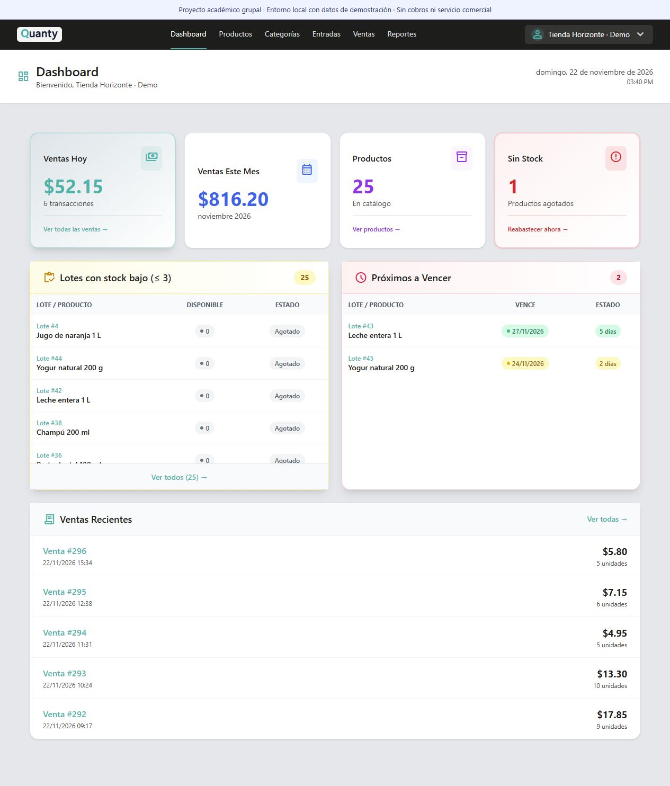
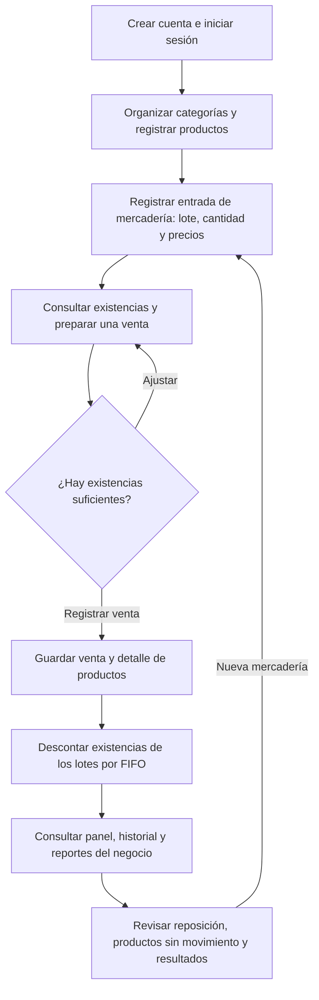
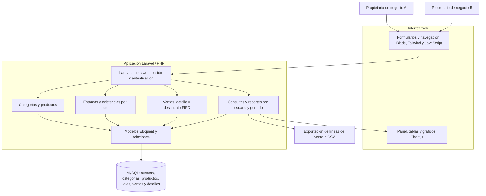

# QUANTY: digitalización de inventario y ventas para pequeños negocios

**PHP · Laravel · MySQL · Inventario por lotes · FIFO · Reportes operativos**

Proyecto académico grupal · Universidad Evangélica de El Salvador · Emprendedurismo · Ciclo 8 de 2025

En QUANTY trabajé con mi grupo en una propuesta para **pasar del cuaderno de una tienda a un registro digital de productos, entradas y ventas**. La idea era que pequeños negocios y emprendimientos utilizaran una misma aplicación web, cada uno con su cuenta y sus registros, y pudieran consultar qué tienen disponible, qué venden y qué productos necesitan atención.

Mi aprendizaje se concentró en **tablas y relaciones de un mini ERP en MySQL, registro e inicio de sesión, entradas de inventario y ventas con FIFO**. En los reportes participé definiendo qué información necesitábamos y cómo queríamos verla, con asistencia de IA para la implementación.

[Origen y alcance](docs/CONTEXTO_DEL_PROYECTO.md) · [Arquitectura](docs/ARQUITECTURA.md) · [Recorridos](docs/RECORRIDOS_DE_USO.md) · [Aprendizajes](docs/RESULTADOS_Y_APRENDIZAJES.md).

## De la idea al sistema

QUANTY surgió en Emprendedurismo alrededor de una necesidad: una tienda que registra compras, existencias y ventas en cuadernos puede tener dificultades para relacionar esos movimientos y saber cómo marcha su operación. Una lista de productos por sí sola tampoco permite conocer qué se vendió, cuánto queda o qué lleva tiempo sin venderse.

La propuesta fue una **herramienta web sencilla para microempresarios, tiendas de abarrotes y otros pequeños emprendimientos**, con una interfaz orientada a las tareas diarias. El propietario registra su catálogo, recibe mercadería, anota ventas y consulta reportes sobre sus propios registros.

En clase desarrollamos la propuesta de valor, el modelo Canvas, la comparación de competidores y la estructura de costos. Estos trabajos ayudaron a pensar a quién iba dirigido el servicio, qué problema atendía y cómo podría sostenerse. El prototipo materializa la gestión operativa; las proyecciones comerciales y los documentos completos se conservan de forma privada.

Como referencia técnica revisamos un ERP en PHP de YouTube y decidimos reconstruir la propuesta con Laravel. El trabajo fue grupal y tuvo asistencia importante de IA en el código, la interfaz y los datos. [Origen, evolución y alcance del proyecto](docs/CONTEXTO_DEL_PROYECTO.md).

## Una aplicación para distintos negocios

La aplicación contempla que **distintos propietarios creen su cuenta y utilicen los mismos módulos con sus propios registros**. El catálogo, las entradas, las ventas y los reportes se relacionan con el usuario que inició sesión.

En este prototipo la cuenta representa al negocio. La separación se realiza dentro de una base compartida mediante la asociación de los registros con su propietario; no se crea una aplicación o una base distinta para cada tienda. Así, el objetivo es ofrecer una herramienta general, no analizar únicamente la tienda ficticia que aparece en las capturas.

## Recorrido del propietario y operación

| Etapa | Qué hace el propietario | Qué conserva el sistema |
|---|---|---|
| Catálogo | Define categorías y productos | Identidad del producto y clasificación |
| Entradas | Registra mercadería recibida, costo, precio y vencimiento | Lotes, cantidades iniciales y disponibles |
| Venta | Selecciona productos y cantidades | Venta, detalle, precios e historial |
| Existencias | Revisa lo que queda y las alertas | Cantidad disponible por lote y producto |
| Reportes | Elige período o tipo de consulta | Lectura de sus ventas e inventario |

Crear un producto y recibir mercadería son pasos distintos: el primero define qué se vende; el segundo incorpora las unidades disponibles y sus precios. Al registrar una venta se guarda su detalle y se descuentan unidades de los lotes más antiguos. [Recorridos detallados de cada módulo](docs/RECORRIDOS_DE_USO.md).

## Arquitectura de la aplicación

Laravel organiza las solicitudes, los módulos y el acceso a los datos; MySQL conserva las relaciones y el historial. La venta se procesa dentro de una transacción para vincular su registro con el movimiento de existencias. Los reportes consultan esos mismos datos y los devuelven como tablas, indicadores y gráficos.

El diagrama describe la solución técnica, no mi nivel de dominio de cada capa. [Arquitectura por capas, modelo de datos y funcionamiento de una venta](docs/ARQUITECTURA.md).

## Para qué sirven los reportes

La finalidad es que **cada negocio pueda entender su propia operación a partir de lo que registra**. Los informes permiten consultar ventas por período, productos más vendidos, inventario disponible, productos sin movimiento, entradas y margen bruto.

Por ejemplo, una tienda con registros como los de la demostración podría detectar un artículo sin ventas recientes, revisar si conviene seguir reponiéndolo y contrastar su vencimiento con las existencias. Si otro producto se vende con frecuencia y queda poco, podría revisar su próxima compra. Son ejemplos de uso de la herramienta, no conclusiones comerciales sobre una empresa real.

Los datos de las capturas son ficticios y ayudan a mostrar cómo responde cada módulo. **El resultado del proyecto es el sistema y su lógica de operación, no los patrones de los datos generados.** [Cómo se relacionan los registros, reportes y decisiones del propietario](docs/DATOS_E_INDICADORES.md).

## Mi participación y lo que aprendí

Participé en la construcción grupal y asistida de la propuesta, trabajando paso a paso en cómo debían relacionarse los registros y funcionar las pantallas. Mis aprendizajes confirmados se concentran en:

- **MySQL y mini ERP:** relacionar usuarios, categorías, productos, entradas, ventas y detalles.
- **Cuentas y acceso:** comprender el recorrido de registro e inicio de sesión y su relación con la información de cada propietario.
- **Inventario y FIFO:** distinguir producto, entrada y lote; relacionar la venta con el descuento de existencias de los lotes más antiguos.
- **Requisitos de reportes:** definir qué información mostrar, de qué registros obtenerla y qué tablas o gráficos resultaban útiles para el negocio.

Para programar las consultas y construir los reportes nos apoyamos en IA. Mi aporte estuvo en su lógica y requisitos; no los implementé escribiendo las consultas de forma autónoma. Mi siguiente paso en Laravel es profundizar en sus rutas, controladores, modelos y vistas.

[Mi participación y uso de IA](docs/PARTICIPACION.md) · [Resultados del proyecto y aprendizajes concretos](docs/RESULTADOS_Y_APRENDIZAJES.md).

## Demostración local y recorrido visual

El proyecto se conserva en un laboratorio Docker con PHP/Apache y MySQL. Esto permite abrir la aplicación, recorrer sus módulos y consultar reportes con una cuenta y datos ficticios. La configuración local y el código permanecen en el repositorio privado.

La galería presenta un recorrido seleccionado de catálogo, entradas, venta, actualización de existencias y reportes; las demás capturas quedan como consulta adicional. [Ver el recorrido visual](docs/RECORRIDO_VISUAL.md).

El alcance comprobado incluye descarga CSV; la opción PDF está marcada como Próximamente. Este repositorio es un **caso académico documental para CV y portafolio**, no un servicio comercial activo. El contexto, la arquitectura y los aprendizajes pueden revisarse sin acceso al código ni a una VPS.

[Contexto completo](docs/CONTEXTO_DEL_PROYECTO.md) · [Índice de evidencias](docs/EVIDENCIAS.md) · [Aviso académico](AVISO_ACADEMICO.md).
