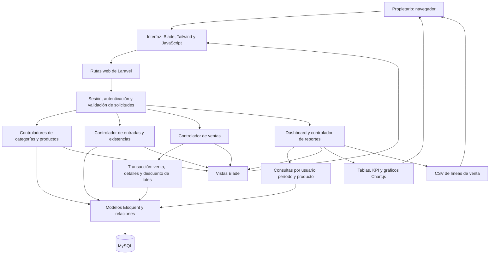
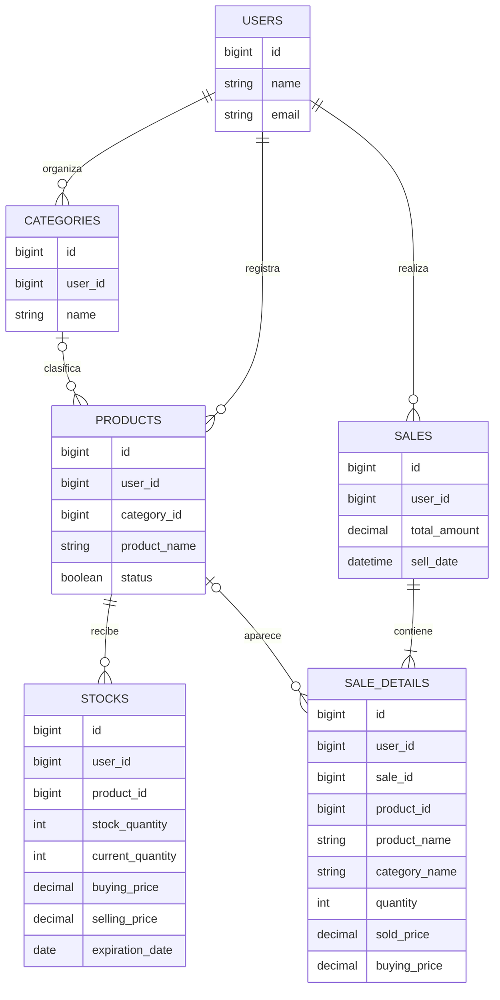
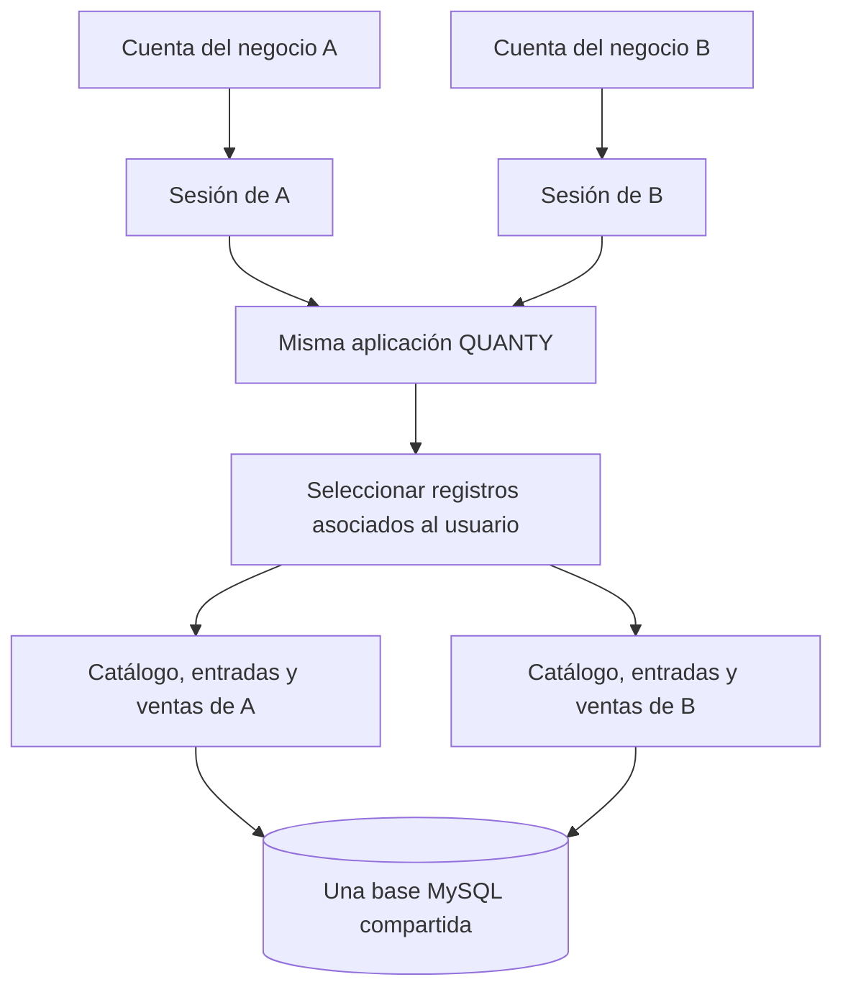
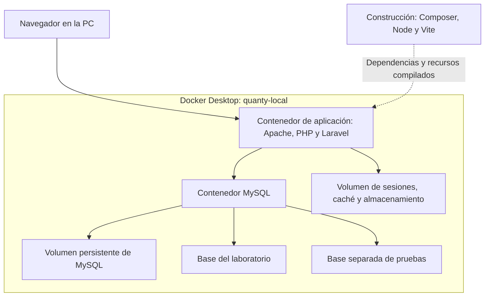

# Arquitectura de QUANTY

## Cómo se relacionan la interfaz, la lógica y los registros

QUANTY es una aplicación web en PHP construida con Laravel y una base relacional MySQL. El propietario interactúa con formularios y pantallas; la aplicación procesa sus solicitudes, relaciona la información con su cuenta y consulta o actualiza los registros del negocio.

La arquitectura reúne varias responsabilidades: acceso, catálogo, entradas de mercadería, ventas, existencias y reportes. No son aplicaciones independientes: son módulos de una misma solución que comparten las relaciones de datos.

El diagrama describe responsabilidades técnicas. La [participación y los aprendizajes](PARTICIPACION.md) distinguen qué conocimientos he trabajado personalmente de las partes implementadas con asistencia.

## Capas y tecnologías

| Capa | Componentes de QUANTY | Responsabilidad |
|---|---|---|
| Presentación | Blade, HTML y Tailwind CSS | Formularios, navegación, tablas, estados y presentación adaptable |
| Interacción | JavaScript, Alpine y solicitudes desde el navegador | Menús, selección de productos, consultas de precio/stock y preparación de la venta |
| Gráficos | Chart.js | Tendencias de ventas, comparación de productos y distribución del inventario o ingresos |
| Entrada de solicitudes | Rutas web y middleware Laravel | Resolver qué operación se solicita, mantener la sesión y requerir autenticación en los módulos |
| Lógica de aplicación | Controladores de categorías, productos, entradas, ventas, panel y reportes | Validar datos, organizar operaciones y preparar información para las vistas |
| Acceso relacional | Eloquent, relaciones y consultas del proyecto | Recuperar y guardar los registros asociados al usuario y al módulo |
| Persistencia | MySQL y migraciones | Conservar cuentas, catálogo, lotes, ventas y detalles; describir la estructura del esquema |
| Construcción | Composer, npm y Vite | Instalar dependencias y compilar los recursos de la interfaz |

Blade genera HTML en el servidor. En la venta, por ejemplo, JavaScript consulta el precio y la cantidad disponible de un producto y permite reunir varios artículos antes de enviar la operación completa. La base de datos sigue siendo la fuente de los registros que utiliza la aplicación.

## Módulos y su relación

| Módulo | Información que recibe | Qué realiza y a qué alimenta |
|---|---|---|
| Cuenta y acceso | Datos de registro o credenciales de una cuenta existente | Crea el usuario, inicia la sesión y permite acceder a los módulos |
| Categorías | Nombre e icono de una clasificación | Organiza los productos del propietario |
| Productos | Nombre, categoría, descripción y estado | Define el catálogo que utilizan las entradas y ventas |
| Entradas | Producto, cantidades, precios y vencimiento | Crea lotes y establece unidades disponibles |
| Ventas | Productos y cantidades elegidos | Guarda una venta con sus detalles y descuenta existencias por FIFO |
| Panel | Ventas, productos y lotes de la cuenta | Resume la operación y muestra alertas de existencias o vencimiento |
| Reportes | Registros del negocio y filtros | Agrupa información por período, producto o categoría y permite exportar líneas de venta |

En el código estas responsabilidades se encuentran en los controladores de `app/Http/Controllers`, los modelos de `app/Models`, las rutas de `routes` y las plantillas de `resources/views`. La implementación se mantiene privada; las rutas de carpetas se citan para explicar la organización del proyecto.

## Modelo relacional

El siguiente modelo es una vista simplificada de las entidades principales. Omite columnas auxiliares para centrarse en la relación entre cuenta, catálogo y movimientos.

Un producto puede recibir distintos lotes. Una venta puede incluir varios productos y cada línea conserva cantidad, precio y datos de identificación. El detalle también guarda valores del momento de la venta, como nombre, categoría y costo, para apoyar la lectura del historial.

Esta separación permite distinguir **lo que existe en el catálogo**, **lo que entró al negocio**, **lo que salió mediante ventas** y **lo que permanece disponible**.

## Uso por distintos propietarios

El prototipo utiliza una cuenta como unidad de separación del negocio. Los registros operativos incluyen `user_id`, y las consultas principales de los módulos utilizan el usuario autenticado para seleccionar la información que presentan. El proyecto también incluye policies y comprobaciones de pertenencia para determinadas operaciones.

El esquema representa pertenencia lógica de registros, no bases separadas ni contenedores por propietario. Tampoco representa perfiles de cajero, administrador o sucursal dentro de una misma tienda: esa estructura no está desarrollada en la versión mostrada. La revisión completa de autorización debe formar parte de una futura preparación para producción.

## Qué ocurre al registrar una venta

La aplicación recibe el conjunto de artículos, calcula el importe, comprueba la pertenencia de los productos y consulta las existencias. Dentro de una transacción crea la venta y sus líneas, guarda los datos relevantes de cada producto y reduce cantidades de los lotes en orden de antigüedad.

La transacción relaciona esas escrituras como una operación: si ocurre un error durante el proceso, la base puede revertir los cambios de esa transacción. No basta con mostrar un total en pantalla; el registro debe mantenerse relacionado con sus detalles y con el inventario.

El método de salida es FIFO. El costo guardado al vender se toma del lote más reciente en esta implementación; por eso la valoración cuando existen costos distintos entre lotes requiere revisión adicional. En la demostración se utilizan costos constantes por producto. Esto no cambia el orden de salida de unidades, pero sí es importante al interpretar el margen.

## Cómo se producen los reportes

Los reportes utilizan las ventas, sus detalles, los productos y los lotes de la cuenta. Según la pantalla, se filtran fechas, se suman cantidades e importes o se agrupan productos y categorías. El servidor entrega los resultados a las vistas y Chart.js los representa en el navegador.

La descarga CSV exporta líneas de venta del período seleccionado. No es una segunda base independiente ni una integración Power BI. El informe visible proviene de los registros de la misma aplicación.

## Ejecución local conservada

El laboratorio actual reúne PHP 8.3/Apache y MySQL 8.0 en servicios Docker. Las dependencias PHP y los recursos del frontend se preparan durante la construcción; Node y Composer no son servicios de negocio separados que el propietario deba administrar.

La aplicación se abre desde la PC y los volúmenes conservan los datos al detenerla. Las claves y accesos se configuran fuera del repositorio público. Algunos recursos de interfaz se cargan desde CDN, por lo que la demostración no se presenta como completamente desconectada de Internet.

[Recorridos de uso](RECORRIDOS_DE_USO.md) · [Datos e indicadores](DATOS_E_INDICADORES.md) · [Recorrido visual](RECORRIDO_VISUAL.md).
