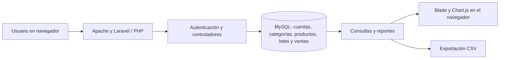

# Arquitectura y alcance

La ejecución demostrada es local. Un contenedor reúne Apache, PHP 8.3 y Laravel 10; otro ejecuta MySQL 8.0. La compilación de Vite se realiza con Node dentro del build. No es necesario instalar PHP, Composer o MySQL en Windows.

Los productos se clasifican por categoría. Las entradas registran cantidades, precios y vencimientos; las ventas conservan líneas con producto, categoría, cantidad, precio y costo. Al registrar la venta se descuentan existencias por lote. Los reportes consultan esos mismos registros: no se generaron gráficos manuales para las capturas ni hay una integración Power BI en esta variante.

El entorno tiene volúmenes propios para persistir MySQL y almacenamiento de Laravel. Publica HTTP solo en la dirección local de la PC; MySQL permanece en la red de Docker. Las claves se generan por separado y no forman parte de este caso documental. Las pruebas usan otra base MySQL para conservar la demostración.

El frontend utiliza Blade, Tailwind, Alpine y Vite; Chart.js representa tendencias, comparaciones y distribución. Algunos recursos se cargan desde CDN. Por ello no se afirma funcionamiento completamente desconectado de Internet. Se desactivó la animación de los gráficos para que el resultado se dibuje completo también al capturar en segundo plano.

Una futura VPS necesitaría su propia configuración y revisión de acceso, HTTPS, respaldos, dependencias y operación. No se presenta como un despliegue activo ni como una restauración ya realizada. La galería y este caso pueden consultarse sin una demo pública de la aplicación.
