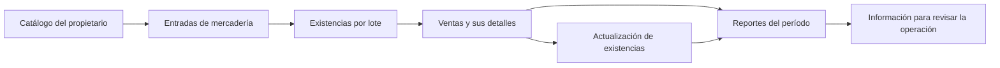

# De los registros diarios a la información del negocio

## La finalidad de los datos en QUANTY

QUANTY busca que el propietario deje de mantener información dispersa y pueda relacionar productos, entradas y ventas. Los reportes son una parte de ese proceso: presentan lo que el negocio ha registrado para que pueda revisar existencias, movimientos y resultados operativos.

La herramienta es general. No presupone que todos los negocios tengan el mismo catálogo ni que deban llegar a las mismas conclusiones. Cada cuenta registra sus artículos y operaciones; los filtros y gráficos presentan la información correspondiente a esa cuenta.

Los datos de la demostración son ficticios. Se usan para que se vean las funciones y puedan explicarse situaciones de uso. No constituyen un estudio de mercado, una muestra de empresas ni un conjunto del que deban extraerse hallazgos comerciales sobre QUANTY.

## Qué información se construye en cada paso

| Registro | Qué representa | Con qué se relaciona |
|---|---|---|
| Cuenta | Propietario que utiliza la aplicación | Catálogo y operaciones asociados al usuario |
| Categoría | Grupo para organizar productos | Productos y lectura de ventas por grupo |
| Producto | Artículo del catálogo | Entradas, existencias y líneas de venta |
| Entrada o lote | Mercadería recibida con cantidad y precios | Unidades disponibles y futuras salidas |
| Venta | Operación registrada en una fecha | Uno o varios detalles de productos |
| Detalle de venta | Producto, cantidad, precio y valores de esa línea | Total de la operación y reportes |

Una entrada aumenta la disponibilidad y una venta consume unidades. El catálogo describe los artículos, mientras que el historial permite saber qué movimientos se registraron. Esta relación es lo que hace útil la información posterior.

## Qué permite leer cada reporte

| Pantalla | Información que organiza | Uso posible para el propietario |
|---|---|---|
| Panel | Ventas del día y mes, cantidad de productos y alertas | Ubicar rápidamente el estado de la operación |
| Ventas por período | Importe, cantidad de ventas, ticket promedio y tendencia | Revisar un intervalo y compararlo con otro de duración comparable |
| Top de productos | Unidades e importes de los artículos del ranking | Ver qué productos se están vendiendo más dentro del filtro |
| Inventario completo | Existencias por producto, lotes y estado | Revisar disponibilidad, artículos críticos y agotados |
| Sin movimiento | Productos con stock que no tuvieron ventas recientes | Revisar mercadería detenida, vencimientos y próximas compras |
| Categorías | Cantidades e ingresos agrupados | Observar cómo se distribuyen las ventas entre grupos de productos |
| Movimientos | Entradas realizadas en el período | Consultar recepciones, cantidades y costo de la mercadería incorporada |
| Ganancias | Ingresos y costo de mercadería registrado | Revisar un margen bruto orientativo por producto y período |
| CSV | Líneas de venta del período | Conservar o revisar el detalle en una hoja de cálculo |

Estos usos son la finalidad de las pantallas. No son conclusiones que obliguen a comprar, descontar o retirar un producto sin revisar el contexto del negocio.

## Ejemplos para entender la utilidad

### Un artículo vende y queda poco

Una tienda podría revisar un producto con ventas frecuentes y pocas unidades disponibles. QUANTY permite ver su stock y sus ventas; el propietario podría contrastar esa información con el tiempo que tarda en recibir nueva mercadería y decidir si necesita reponer.

La aplicación organiza los datos necesarios para esa revisión. No calcula por sí sola toda la demanda futura ni conoce las condiciones del proveedor.

### Hay mercadería sin ventas recientes

Si una tienda tuviera datos como los de la captura de productos sin movimiento, podría identificar los artículos que conserva sin ventas dentro del intervalo seleccionado. A partir de ahí puede revisar su ubicación, presentación, vencimiento o conveniencia de una nueva compra.

No sería correcto concluir automáticamente que el producto es malo, que debe descontarse o que ya produjo una pérdida. La finalidad del reporte es hacer visible una situación que merece revisión.

### Una entrada y una venta deben coincidir con lo disponible

El recorrido visual incorpora 30 unidades de granola y después vende dos. El resultado disponible es 28. Esa operación sencilla muestra la relación entre entrada, venta y saldo; no se presenta como un resultado comercial del proyecto.

### Una categoría aporta una parte del ingreso

El gráfico de categorías permite al propietario observar de dónde proceden sus ingresos registrados. Esa distribución no demuestra por sí sola rentabilidad: para revisar el margen necesita considerar el costo de mercadería y, para una utilidad neta, también los demás gastos del negocio.

## Conceptos que conviene distinguir

| Concepto | Cómo debe leerse |
|---|---|
| Venta y línea de venta | Una operación puede incluir varios productos; cada fila de detalle no es una venta adicional |
| Cantidad y dinero | Las unidades vendidas y el importe monetario son medidas distintas, aunque aparezcan en un mismo gráfico |
| Producto y lote | Un producto puede tener varias entradas; un lote agotado no implica que todo el producto esté agotado |
| Stock crítico | En el reporte se utiliza el umbral de hasta tres unidades disponibles; es una regla del prototipo |
| Valor del inventario mostrado | Se calcula a precio de venta; no representa automáticamente el costo de adquisición |
| Sin movimiento | Depende del período elegido y de la existencia de ventas registradas |
| Ganancia mostrada | Es margen bruto según el costo guardado, antes de gastos operativos e impuestos |
| Total de un Top | Corresponde al conjunto de productos elegido, no necesariamente a todo el negocio |
| Transacciones por categoría | Una venta puede aparecer en más de una categoría; las filas no se suman para obtener ventas únicas |

Los filtros también importan: un mes parcial y un mes completo no son equivalentes, y algunos KPI superiores mantienen el resumen general mientras la tabla muestra el filtro aplicado.

## Datos ficticios y archivos de consulta

La cuenta de demostración reúne categorías, productos, lotes y ventas para poblar los distintos módulos. También se recorrieron desde la interfaz el alta de un producto, una entrada y una venta. Las pantallas conservan sus registros y muestran su relación.

El [resumen de la demostración](../datos/resumen-demostracion.json) y el [CSV ficticio](../datos/ventas-simuladas-noviembre.csv) se conservan como consulta adicional. No son el resultado principal del caso ni una base de investigación sobre negocios reales. En el CSV, el encabezado heredado «Total Venta» representa el subtotal de cada línea: para revisar una operación completa deben agruparse sus filas por ID.

El alcance mostrado incluye CSV. PDF figura como Próximamente. Cuando los costos cambian entre lotes, el método de valoración requiere una revisión adicional, como se explica en [arquitectura](ARQUITECTURA.md#qué-ocurre-al-registrar-una-venta).

[Recorrido visual](RECORRIDO_VISUAL.md) · [Resultados y aprendizajes](RESULTADOS_Y_APRENDIZAJES.md).
