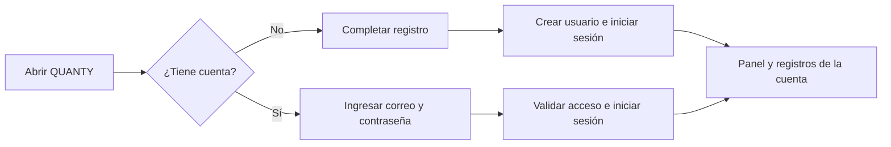
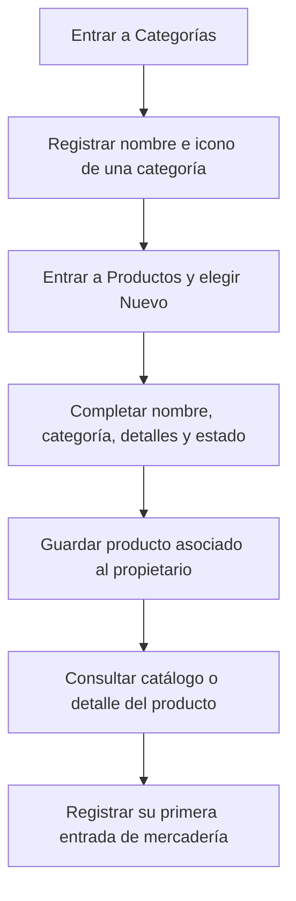
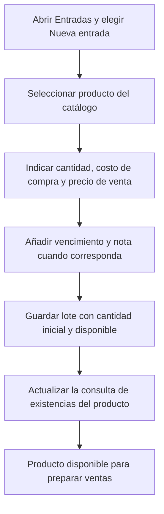
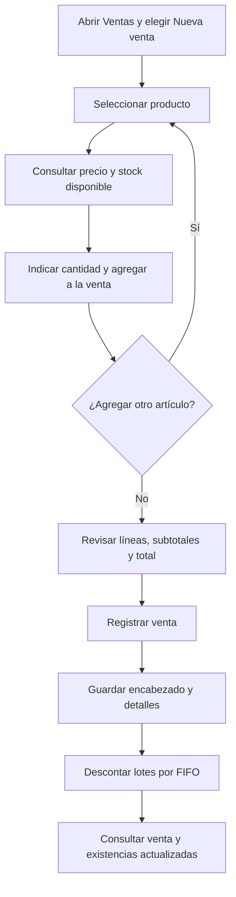
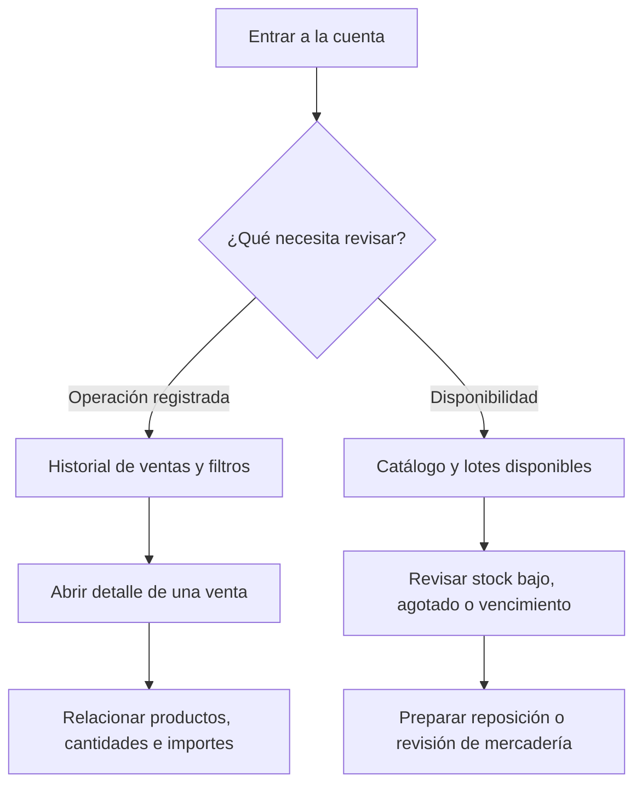
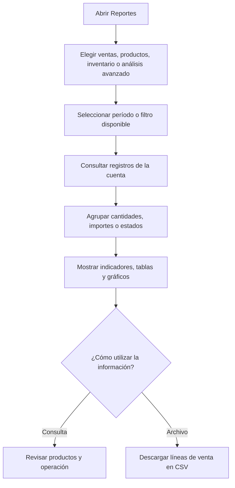

# Recorridos de uso de QUANTY

Los siguientes diagramas explican las tareas del propietario y la información que conecta cada módulo. Son recorridos del sistema, no una secuencia obligatoria de todas las pantallas en cada sesión.

## 1. Crear una cuenta y acceder al negocio

La sesión identifica al propietario que está trabajando. El registro no crea productos ni mercadería: deja la cuenta disponible para comenzar a organizar el negocio. El catálogo, las entradas y las ventas se relacionan después con ese usuario.

## 2. Organizar categorías y crear productos

Una categoría agrupa productos. El producto define qué artículo se maneja, pero su creación por sí sola no incorpora unidades disponibles. Esa distinción evita confundir una ficha del catálogo con una compra o recepción de mercadería.

Las capturas de [nuevo producto](img/05-nuevo-producto.jpg) y [producto creado](img/06-producto-creado.jpg) muestran este primer paso. En el segundo todavía aparece sin existencias porque aún no se ha registrado una entrada.

## 3. Recibir mercadería y crear un lote

Un mismo producto puede recibir varias entradas. El lote conserva cuánto ingresó y cuánto queda, además de sus precios y vencimiento. El propietario puede revisar ese historial para relacionar reposiciones y salidas.

La [entrada de demostración](img/08-nueva-entrada.jpg) incorpora 30 unidades de granola. La cifra sirve para seguir la operación de principio a fin, no para analizar un negocio real.

## 4. Preparar y registrar una venta

Antes de registrar la venta, la interfaz consulta precio y existencias. Cada artículo agregado forma una línea con cantidad y subtotal. El registro final conserva la venta y sus detalles, y actualiza el inventario.

Si un producto no tiene existencias, la interfaz muestra la alerta y deshabilita su incorporación. La validación completa del servidor y de todos los casos de entrada forma parte del trabajo de consolidación de la aplicación; una alerta visual no sustituye esos controles.

### Ejemplo para comprender FIFO

Si un producto tiene un lote antiguo con 5 unidades y otro posterior con 8, una salida de 7 unidades consume las 5 del primero y 2 del segundo. El primero queda agotado y el segundo conserva 6.

Ese ejemplo explica **orden de salida**. No debe confundirse con una afirmación sobre el método de valoración monetaria de la implementación. [Detalle técnico de la venta](ARQUITECTURA.md#qué-ocurre-al-registrar-una-venta).

En el recorrido fotografiado se venden dos granolas y tres aguas. Se puede contrastar la [venta preparada](img/11-venta-lista.jpg), el [detalle guardado](img/13-detalle-venta.jpg) y las [28 unidades de granola que quedan](img/27-producto-despues-venta.jpg).

## 5. Consultar ventas e inventario

El historial permite volver a una operación; el inventario permite revisar lo que sigue disponible. La misma venta aparece desde perspectivas distintas: como registro comercial interno y como salida de existencias.

## 6. Consultar reportes del negocio

Los reportes resumen lo que el propietario ha registrado. Su utilidad depende de que catálogo, entradas y ventas se mantengan al día y de que el período elegido corresponda a la consulta que desea hacer.

[Qué comunica cada reporte](DATOS_E_INDICADORES.md) · [Galería de pantallas](RECORRIDO_VISUAL.md).
