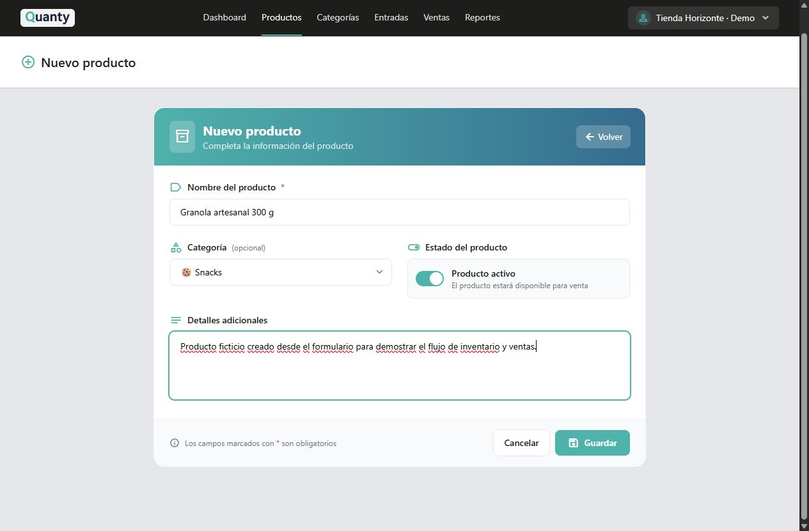
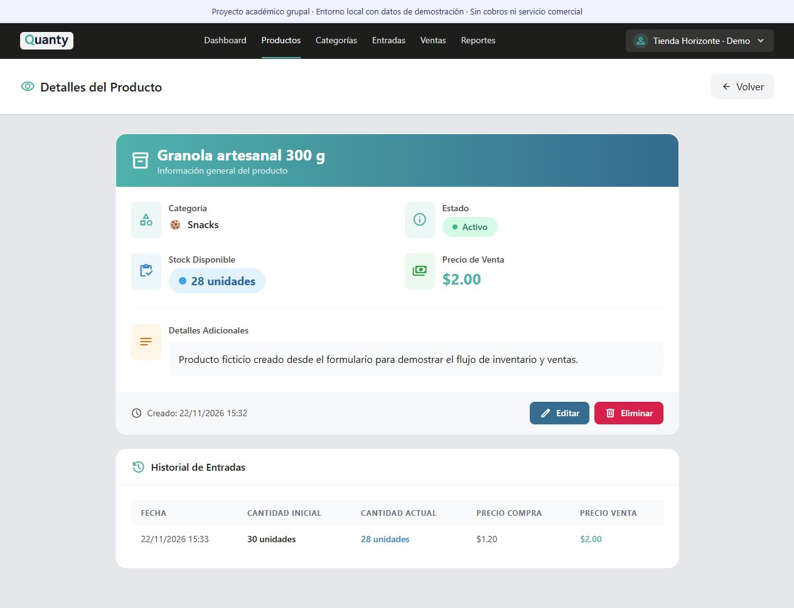
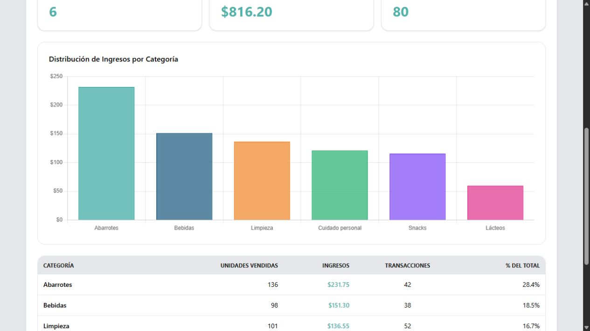

# Recorrido visual de QUANTY

Esta galería sigue la operación de un propietario: revisar el panel, definir un producto, recibir mercadería, registrar una venta y volver a consultar las existencias y reportes. Se utilizan una cuenta y datos ficticios para mostrar cómo funcionaría el mismo recorrido con los registros de otro negocio.

La selección principal contiene seis vistas. Al final hay enlaces a las demás pantallas para quien quiera revisar un módulo específico, sin interrumpir la explicación con todas las imágenes a la vez.

## 1. Ubicar la operación desde el panel

El panel reúne ventas del día y mes, productos registrados y alertas de existencias o vencimiento. Su finalidad es dar al propietario una primera lectura de su cuenta antes de entrar a un módulo concreto.

Las alertas de lotes y el estado de productos deben distinguirse: un producto puede conservar unidades en otro lote aunque uno de sus lotes esté agotado.

## 2. Registrar qué se va a vender

El formulario de producto reúne nombre, categoría, descripción y estado. Esta es la ficha del catálogo. Todavía no representa una entrada de mercadería ni garantiza que haya unidades disponibles.

## 3. Incorporar mercadería mediante una entrada

La entrada selecciona un producto ya existente e incorpora un lote con cantidad, costo de compra, precio de venta y vencimiento cuando corresponda. Esta distinción entre producto y lote es parte de la lógica del inventario.

En el ejemplo se ingresan 30 unidades de granola. Ese número permite seguir la operación posterior y comprobar visualmente qué ocurre con las existencias.

## 4. Preparar una venta con varios artículos

La venta consulta precio y disponibilidad, permite agregar productos y muestra cantidades, subtotales y total. Al registrarse, la aplicación guarda el encabezado y los detalles y descuenta existencias de los lotes.

La imagen muestra dos granolas y tres aguas antes de registrar. Su finalidad es explicar la interacción del formulario, no presentar un resultado de ventas de una empresa real.

## 5. Volver al producto y relacionar entrada, salida y saldo

Después de vender dos de las 30 granolas ingresadas, el detalle muestra 28 disponibles y conserva la entrada en el historial. El propietario puede relacionar el catálogo con el lote recibido y las salidas registradas.

## 6. Consultar información organizada del negocio

Los reportes utilizan los registros de la cuenta. En esta vista, un gráfico distribuye los ingresos entre categorías y la tabla permite revisar las cantidades e importes que lo acompañan.

Una tienda con sus propios datos podría usar esa lectura para revisar su surtido o las ventas por grupo. La captura explica la función del reporte; sus importes ficticios no se presentan como hallazgos de QUANTY.

## Consultar otras pantallas

### Acceso y cuenta

| Vista | Qué permite revisar |
|---|---|
| [Portada](img/01-portada.jpg) | Presentación de la propuesta y acceso |
| [Inicio de sesión](img/02-login.jpg) | Formulario de acceso |
| [Registro](img/31-registro.jpg) | Formulario para crear una cuenta |
| [Perfil de demostración](img/32-perfil-demo.jpg) | Datos de cuenta y opciones de perfil, sin contraseñas introducidas |

### Catálogo y entradas

| Vista | Qué permite revisar |
|---|---|
| [Categorías](img/14-categorias.jpg) | Clasificación del catálogo |
| [Formulario de categoría](img/15-formulario-categoria.jpg) | Nombre e icono |
| [Productos](img/04-productos.jpg) | Catálogo inicial y estados |
| [Producto recién creado](img/06-producto-creado.jpg) | Ficha anterior a la primera entrada |
| [Edición de producto](img/28-editar-producto.jpg) | Información recuperada para modificarla |
| [Historial de entradas](img/07-entradas.jpg) | Cantidades, precios y fechas de lotes |
| [Entrada registrada](img/09-entrada-registrada.jpg) | Confirmación de la recepción de mercadería |
| [Edición del lote](img/29-editar-lote.jpg) | Cantidad inicial, disponible y vencimiento |

### Ventas e historial

| Vista | Qué permite revisar |
|---|---|
| [Seleccionar producto](img/10-seleccionar-producto-venta.jpg) | Precio y disponibilidad consultados por la venta |
| [Venta registrada](img/12-venta-registrada.jpg) | Confirmación y operación en el historial |
| [Detalle de venta](img/13-detalle-venta.jpg) | Productos, cantidades y subtotales guardados |
| [Filtros de ventas](img/30-filtros-ventas.jpg) | Consulta de una operación específica |
| [Alerta de producto agotado](img/34-alerta-sin-stock.jpg) | Advertencia y bloqueo de incorporación desde la interfaz |

### Reportes y consultas

| Vista | Qué permite revisar |
|---|---|
| [Centro de reportes](img/16-centro-reportes.jpg) | Tipos de consulta disponibles |
| [Ventas por día](img/17-ventas-por-dia.jpg) | Filtros, indicadores y tendencia diaria |
| [Ventas por semana](img/18-ventas-por-semana.jpg) | Agrupación semanal del intervalo |
| [Ventas por mes](img/33-ventas-por-mes.jpg) | Agrupación mensual, con atención a períodos parciales |
| [Top de productos](img/19-top-productos.jpg) | Ranking por unidades e importes del subconjunto |
| [Inventario completo](img/20-inventario-completo.jpg) | Estado, disponibilidad y distribución |
| [Stock crítico](img/26-filtro-stock-critico.jpg) | Tabla filtrada de productos con pocas unidades |
| [Sin movimiento](img/21-sin-movimiento.jpg) | Mercadería sin ventas recientes |
| [Resumen por categorías](img/22-ventas-categorias.jpg) | Totales y ventas únicas del período |
| [Tabla por categorías](img/36-tabla-categorias.jpg) | Detalle de cantidades, importes y participaciones |
| [Movimientos de stock](img/23-movimientos-stock.jpg) | Recepciones del período |
| [Ganancias](img/24-ganancias.jpg) | Ingresos, costo registrado y margen bruto |
| [Exportación](img/25-exportar-csv.jpg) | CSV disponible y PDF marcado como Próximamente |

## Alcance de las imágenes

Las 36 capturas corresponden a la demostración local del 22/11/2026. La secuencia incluye vistas anteriores y posteriores al alta del producto y a su venta. Las pantallas de edición muestran formularios; no significan que en cada una se haya guardado otra modificación.

Algunas imágenes muestran la parte superior de un reporte o un detalle de gráfico/tabla para conservar la legibilidad. Los módulos y filtros se explican en los [recorridos de uso](RECORRIDOS_DE_USO.md) y en [datos e indicadores](DATOS_E_INDICADORES.md). El [índice de evidencias](EVIDENCIAS.md) relaciona estas vistas con las capacidades del proyecto.
